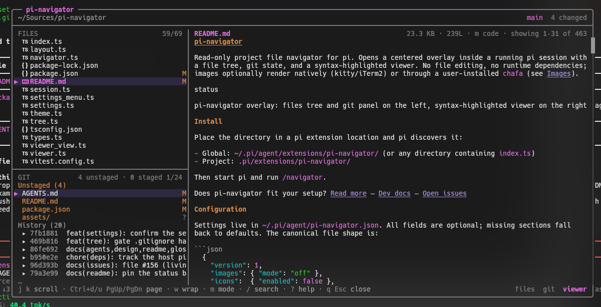
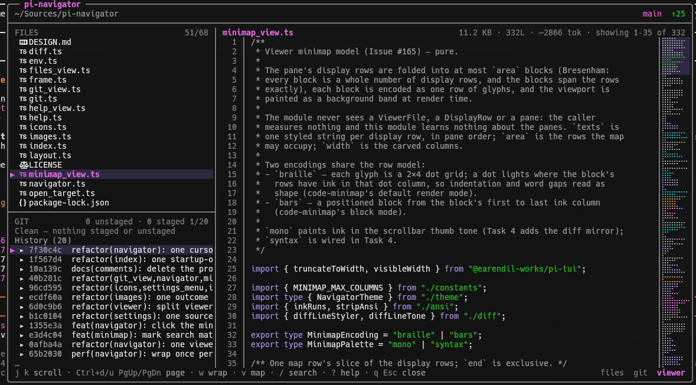

# pi-navigator

Read-only project file navigator for pi. Opens a centered overlay inside a running pi session with a file tree, git state, and a syntax-highlighted viewer. No file editing, no runtime dependencies; images optionally render natively (kitty/iTerm2) or through a user-installed `chafa` (see [Images](#images-optional)).




## Install

```bash
pi install npm:@lordekeen/pi-navigator   # or: pi install git:github.com/lordekeen/pi-navigator
```

For local development, place the directory in a pi extension location and pi discovers it:

- Global: `~/.pi/agent/extensions/pi-navigator/` (or any directory containing `index.ts`)
- Project: `.pi/extensions/pi-navigator/`

Then start pi and run `/navigator`.

Does pi-navigator fit your setup? [Read more](./AGENTS.md)

## Configuration

Settings live in `~/.pi/agent/pi-navigator.json`. All fields are optional; missing sections fall back to defaults. The canonical file shape is:

```json
{
  "version": 1,
  "images": { "mode": "off" },
  "icons":  { "enabled": false },
  "viewer": { "wrap": false, "markdown": "code" },
  "tree":   { "showHidden": false, "respectGitignore": true },
  "layout": { "default": "files-git-viewer" }
}
```

| Field | Default | Options | Effect |
| --- | --- | --- | --- |
| `images.mode` | `off` | `off`, `chafa`, `native`, `auto` | Image tier: `chafa` symbol art (requires pi-chafa + chafa), `native` kitty/iTerm2 graphics, `auto` (native then chafa), or `off` (metadata card) |
| `icons.enabled` | `false` | `true`, `false` | Show a Nerd Font filetype icon column in the file tree (requires a Nerd Font terminal) |
| `viewer.wrap` | `false` | `true`, `false` | Start files with word wrap enabled; the `w` key still toggles it per session |
| `viewer.markdown` | `code` | `code`, `rendered` | Open Markdown files as rendered text or plain code; the `m` key still toggles it per session |
| `viewer.minimap` | `braille` | `off`, `braille`, `bars` | Show a minimap column in the viewer: `braille` dots, positioned `bars`, or `off`; the `v` key toggles it per session |
| `viewer.minimapColors` | `mono` | `mono`, `syntax` | Minimap palette: `mono` (scrollbar tone, diff-status colours) or `syntax` (each row takes its dominant syntax colour) |
| `viewer.minimapWidth` | `7` | 4–12 | Minimap width in columns (4–12), plus its one-column `│` divider; the map hides itself when the remaining content width would drop under 36 |
| `tree.showHidden` | `false` | `true`, `false` | Start with hidden files visible; the `.` key still toggles it per session |
| `tree.respectGitignore` | `true` | `true`, `false` | Hide untracked files and directories ignored by Git in the tree (git's full ignore stack; requires a git repository). Tracked files always show; without git the filesystem walk keeps its static ignore list, so the setting is a no-op there |
| `layout.default` | `files-git-viewer` | `files-git-viewer`, `files-viewer`, `git-viewer` | Layout opened by bare `/navigator`; `/navigator all`, `/navigator files`, and `/navigator git` always open their own layout for one session |

Environment variables override the file, and launcher flags override both (precedence: defaults ← file ← env ← flags):

| Variable | Values |
| --- | --- |
| `PI_NAV_IMAGES` | `chafa`/`native`/`auto` select that mode; `1`/`true`/`yes`/`on` enable chafa; `0`/`false`/`no`/`off` disable; anything else warns and the file value stands; empty/whitespace is no override |
| `PI_NAV_ICONS` | `1`/`true`/`yes`/`on` enable the icon column; `0`/`false`/`no`/`off` disable; anything else warns and the file value stands; empty/whitespace is no override |
| `PI_NAV_LAYOUT` | `files-git-viewer`/`files-viewer`/`git-viewer` select the default layout; anything else warns and the file value stands; empty/whitespace is no override |

Edit either the file or the variables in your shell profile (e.g. `export PI_NAV_ICONS=1` in `~/.zshrc`) before launching pi, or pass inline: `PI_NAV_ICONS=1 pi`.

Launcher flags are the only layer you can discover from the terminal — they are listed in `pi --help` (env vars never are) — and they apply to that run only:

| Flag | Values |
| --- | --- |
| `--navigator-images <value>` | The same values `PI_NAV_IMAGES` accepts |
| `--navigator-icons` | Boolean: passing it enables the icon column; omit it and the file/env value stands |
| `--navigator-layout <value>` | The same values `PI_NAV_LAYOUT` accepts |

**`/navigator set <field> <value>`** writes a single field without opening the menu, through the same registry and validator the menu uses — so it works where the menu cannot mount (`-p` / print and json mode) and from scripts that provision a later session. Field ids are the ones in the table above: `/navigator set images.mode native`, `/navigator set viewer.wrap on`, `/navigator set layout.default git-viewer`. Booleans take `on`/`off`; enums take the listed tokens. A bad field or value warns with a one-line usage and writes nothing. If a flag or environment variable will shadow the field you just wrote, the notice says so — the file is updated, but the more explicit layer still wins for the running session.

In `-p` / print and json mode the UI commands (`/navigator`, `/navigator settings`) refuse **silently**: the host's `notify` is a no-op there, so an extension has no channel to report through, and json mode's stdout is contractually a single machine-readable document. That is a deliberate, documented deviation rather than an oversight — `set` is the path those modes can use, and it needs no UI at all.

**`/navigator settings`** opens a settings menu (interactive TUI) over the same fields — Enter/Space cycles a row into an in-memory draft; Ctrl+S saves and closes, writing all changes atomically in one shot; Esc discards the draft without writing. Rows whose runtime requirement is missing carry a note (e.g. `images.mode` notes chafa + pi-chafa). The menu follows the host settings-panel standard: it docks above the message input, uses the host list roles (bright labels, muted values), and is framed by full-width rules like pi's own `/settings`; mouse wheel and click work in fullscreen mode. Rows shadowed by an environment variable are annotated (`— overridden by PI_NAV_IMAGES (env wins)`); editing one still writes the file, and the env value stays effective until it is unset. Settings are read once per `/navigator` invocation, so **changes apply the next time /navigator opens** — there is nothing applied live mid-session.

Icons depend on a terminal Nerd Font — without one, glyphs render as placeholder boxes (tofu). The overlay shows a one-time, non-blocking hint when icons are on. The git pane, commit-family view, and viewer follow the active pi theme with no hardcoded colors.

## Usage

```
/navigator              open the overlay (layout.default setting)
/navigator all          open the files + git + viewer overlay (default layout)
/navigator files        open the files + viewer overlay
/navigator git          open the git + viewer overlay
/navigator settings     open the settings menu (interactive TUI)
/navigator set          write one config value (no UI at all)
/navigator help         show this command list
```

`/navigator <anything else>` warns and shows the help list. Surplus arguments after a known subcommand get a one-line usage notice instead, with no help appended (Issue #134). `settings` requires the interactive TUI: it warns in RPC and refuses silently in print/json (where the host `notify` is a no-op). `set` needs no UI at all and works in every mode (see [Configuration](#configuration)).

Layout: the left column holds the files tree and the git panel (`files-git-viewer`, the default), the files tree alone (`files-viewer`), or the git panel alone (`git-viewer`); the file viewer sits on the right in every layout, and contextual key hints live in the footer — typed key/label pairs (`dim` keys, `muted` labels, joined by ` · `), with the close pair advertising the cancel key (`q Esc close`). The frame is rounded (`╭ ╮ ╰ ╯`) with the product name in a pill on the top border, the row below is a path/git subtitle, and an overflowing viewer shows a `showing 1–25 of 120` readout in its header plus a proportional scrollbar in the frame's right border. A layout is chosen when the overlay opens — by the direct command, or by `layout.default`/`PI_NAV_LAYOUT` for bare `/navigator` — and is fixed for that overlay's lifetime; it never switches mid-session and the direct commands never write settings. A stylized example at 100×28 (one of the render suite's sizes; colors omitted):

```
╭── pi-navigator ──────────────────────────────────────────────────────────────────────────────────╮
│ ~/project                                                                  main  ↑2 ↓1 4 changed │
├──────────────────────────────────────────────────────────────────────────────────────────────────┤
│ FILES                   1/8 │ src/main.ts         2.1 KB · 120L · ~530 tok · showing 1–17 of 120 │
│▶ ▾ docs                     │   1 │ // pi-navigator overlay entry                                █
│    ▸ design                 │   2 │ import { loadTree } from "./utils";                          █
│  ▾ src                     •│   3 │                                                              │
│    ▸ lib                    │   4 │ export function main(): void {                               │
│    main.ts                 M│   5 │   const tree = loadTree(process.cwd());                      │
│    utils.ts                ?│   6 │   console.log(tree.length, "entries");                       │
│  package.json               │   7 │ }                                                            │
│  README.md                  │   8 │                                                              │
├─────────────────────────────┤   9 │ // ...                                                       │
│ GIT   2 unstaged · 2 staged │  10 │ // line 10                                                   │
│ Unstaged (2)                │  11 │ // line 11                                                   │
│▶ src/main.ts               M│  12 │ // line 12                                                   │
│  docs/design/overview.md   M│  13 │ // line 13                                                   │
│ Staged (2)                  │  14 │ // line 14                                                   │
│  src/utils.ts              A│  15 │ // line 15                                                   │
│  package.json              M│  16 │ // line 16                                                   │
│ …                           │  17 │ // line 17                                                   │
│ j k move · Enter open · g G Home/End jump · Tab pane · / filter · . hidden    files  git  viewer │
╰──────────────────────────────────────────────────────────────────────────────────────────────────╯
```

## Keys

| Scope | Key | Action |
|---|---|---|
| Global | `Tab` / `Shift+Tab` | Cycle focus across the visible panes (files, git, viewer in the default layout; two panes in the single-pane layouts) |
| Global | `t` | Toggle the left column |
| Global | `r` | Refresh tree, git, and the open file |
| Global | `?` | Help modal |
| Global | `q` | Close the overlay |
| Global | `Esc` | Clear filter, then search, then close |
| Global | `y` | Copy the selection: file path, or commit hash in history |
| Files | `j` `k` / arrows | Move |
| Files | `Ctrl+d` `Ctrl+u` / `PgUp` `PgDn` | Half page |
| Files | `g` `G` / `Home` `End` | Top, bottom |
| Files | `Enter` | Open a file (focuses the viewer), or toggle a directory |
| Files | `l` `h` / arrows | Expand, collapse a directory |
| Files | `/` | Incremental fuzzy filter (name matches rank first) |
| Files | `.` | Toggle hidden dot entries |
| Git | `j` `k` / arrows | Move through changed files and history |
| Git | `Ctrl+d` `Ctrl+u` / `PgUp` `PgDn` | Half page |
| Git | `Enter` | Open the changed file (expands the tree to it); on a commit row, show its diff in the viewer |
| Git | `l` `h` / arrows | Expand, collapse a commit's ancestor family (one level at a time) |
| Git | `g` `G` / `Home` `End` | Top, bottom |
| Viewer | `j` `k` / arrows | Scroll |
| Viewer | `Ctrl+d` `Ctrl+u` / `PgUp` `PgDn`, `g` `G` / `Home` `End` | Half page, top, bottom |
| Viewer | `/` | Search (smart case, incremental) |
| Viewer | `n` `N` | Next, previous match |
| Viewer | `w` | Toggle word wrap |
| Viewer | `m` | Toggle markdown rendered / code view |
| Viewer | `i` | Toggle image rendering / metadata card (native or chafa) |
| Viewer | `v` | Toggle the minimap (this session; `viewer.minimap` sets the start) |
| Viewer | `h` `l` / arrows | Horizontal scroll when wrap is off |

Esc precedence in one line: filter, then search, then close. Search mode adds `↑` `↓` / `Ctrl+n` `Ctrl+p` to cycle matches and `Enter` to apply; the `?` modal lists the full set including these aliases.

### Minimap

A narrow column on the viewer's right edge maps the open file: braille by default (a dot grid where the file has ink, so indentation and line length read as shape), positioned bars if you prefer `viewer.minimap: bars`, or off. The whole file always fits vertically — however many lines it has, they fold into the rows the pane has — and the viewport band marks what you are looking at now. Search matches appear in the map as marks: matched rows take the search-match tone, the current match its underline, so a long-file search reads at a glance. Clicking a map row jumps the viewer to that part of the file and focuses the pane; the keyboard reaches every position the map can. Diffs colour by status (added, removed, hunk, meta); `viewer.minimapColors: syntax` colours each row by its dominant syntax colour instead. A `│` divider in the frame tone separates the map from the content, the same separator the line-number gutter uses.

While the map is on it is the viewer's only position cue: the right border's proportional thumb is suppressed, so the two can never disagree about where you are. Turn the map off (or let it auto-hide) and the thumb is back.

The map appears only when the file actually scrolls (a short file shows nothing), hides itself when the pane would be left under 36 content columns, and takes its columns from the viewer's text width — so the visible text is narrower by `viewer.minimapWidth` columns plus the divider (7 by default, 4–12) while the map is on. `v` toggles it for the session; `viewer.minimap`, `viewer.minimapColors` and `viewer.minimapWidth` set the start.

One honest limit: the map's appearance test is the file's **source line count**, not its rendered height. A file with few source lines that overflows only because its lines wrap, or a small markdown file that expands when rendered, scrolls without a map. The exact test would mean rendering markdown twice per pass, which the viewer does not do.



## Behavior notes

- Launch mechanism: the extension is launched via the `/navigator` command, avoiding keybinding conflicts with pi's built-in shortcuts (such as `ctrl+n` / `app.session.toggleNamedFilter`).

- Syntax highlighting uses pi's own `highlightCode` and `getLanguageFromPath`, so colors follow the active theme and no tools like `bat` are needed.
- Tree source is hybrid: inside a repository it lists tracked plus untracked non-ignored files; ignored untracked paths stay hidden by default (git's full ignore stack: `.gitignore`, nested `.gitignore`, `.git/info/exclude`, the global excludes file), and `tree.respectGitignore: false` shows them instead — ignored files with a dim `!` badge and ignored directories expandable. Tracked files matched by an ignore pattern always remain visible. Without git, or in a repository with nothing to list yet (a fresh `git init`), the tree falls back to an async filesystem walk with a static ignore list, dot entries included but hidden by default — inside a repository that fallback is still filtered through git's ignore rules when the setting is on, while with no git binary or repository the rules cannot be resolved, so the setting is a documented no-op there (a `.gitignore` parser remains out of scope).
- Git panel: branch or detached HEAD, ahead and behind counters, unstaged and staged lists, last 20 commits. All git calls are async with a 3 s timeout; the panel shows a single explanation row when git is missing or the cwd is not a repository, and a dim `Clean` row when nothing is staged or unstaged. Status and the tracked listing are read with `-z`, so paths containing spaces, quotes or newlines survive intact.
- Commit rows: `Enter` opens the commit's diff in the viewer (prefix-styled `+`/`-`/`@@` lines, a stat summary notice, and a `commit <hash>` header); `l` expands one level of its ancestor family (`▸`/`▾` markers), `h` collapses and steps out to the anchor. Expanding is capped by `FAMILY_MAX_DEPTH` (a notice tells you when you hit the floor) and `FAMILY_MAX_ROWS` (a dim `… more ancestors` hint marks the cut).
- Refresh runs every 3 s while something changes or a key is pressed, backing off to at most 10 s on an idle overlay, plus `r`, with one refresh in flight at a time: a tick that arrives mid-refresh is dropped. Git state is re-read every tick; the tree is re-collected only when a cheap probe changes — the porcelain-derived signature in git mode, the modification times of the expanded directories in fs mode — and rebuilt only when the path set itself changes, with git codes otherwise stamped in place. Expanded and collapsed directories, top-level ones included, are preserved across rebuilds. Repeated failures notify once per distinct message instead of once per tick.
- Hidden dot entries render dim, and the `.` toggle is Files-scoped.
- Caps: files over 1 MB are read head-capped at 1 MB; files over 5000 lines within 1 MB are read once, then truncated. Both open truncated with a notice. The truncated view reports the total line count when the whole file was read and it is under 256 KB. Text files carry a `~N tok` header estimate — pi's chars/4 context-budget heuristic over the shown text (the displayed head when truncated), marked `~` because no offline tokenizer exists for the running model. Binary files are detected by a NUL byte and shown as a metadata card; images show a metadata card, native terminal graphics or chafa symbol art when the optional image tier is enabled (see [Images](#images-optional)).
- While filtering or searching, the typed query is echoed with a reverse-video cursor, preceded by the hardware cursor marker while the overlay has focus, so IME composition lands over the right cell.
- Never writes to the workspace. The only mutating operations in the whole extension are clipboard copies for `y`.
- Minimum terminal size: the overlay asks for 80 columns; below 72 inner columns the left column hides (toggle `t`); below 40 columns or 8 body rows it renders a compact "terminal too small" notice instead of the frame.

## Images (optional)

Image files show a metadata card (name, size, dimensions) by default. Set
`"images": { "mode": … }` in `~/.pi/agent/pi-navigator.json` (or `PI_NAV_IMAGES`)
to pick a tier:

| Mode | Behavior |
| :--- | :--- |
| `off` (default) | Metadata card only. |
| `native` | Real terminal graphics when the terminal speaks kitty or iTerm2 and the file is renderable (kitty: PNG, or JPEG/WebP/GIF transcoded to PNG; iTerm2: PNG/JPEG/GIF/WebP); otherwise the card explains why. No chafa or pi-chafa needed. |
| `chafa` | chafa symbol art — requires **chafa ≥ 1.10** plus the **pi-chafa** extension — degrading to the card. |
| `auto` | Native when capable, then chafa, then the card — decided per file (JPEG/WebP/GIF render natively on kitty via PNG transcoding; formats the terminal cannot render fall back to chafa when available). pi-chafa's `preferNative: false` (or `CHAFA_PREFER_NATIVE=0`) makes `auto` choose chafa. |

One host gate sits above the mode: `terminal.showImages: false` disables every tier, including `chafa` and `auto`.

Native rendering reuses pi-tui's kitty/iTerm2 encoders (pi-navigator emits no
protocol bytes of its own, except a one-shot kitty `a=q` decode query on the
first native render of each `/navigator` open — the terminal's own OK/error reply
decides whether native stays enabled for that invocation; `OK` keeps it, an
explicit error degrades images to chafa or the card, and an unanswered query
keeps the current behavior) and reads at most 4 MiB per image. The
image is bounded by the viewer pane and by pi's `terminal.imageWidthCells`
preference. Fullscreen (`tuiMode: fullscreen`) supports kitty only — pi-tui
disables iTerm2 images there. **tmux/screen** and terminals without image
support (Alacritty, VS Code, Zed, Windows Terminal, JetBrains) keep native
off — not even a forced `terminal.images` or `PI_IMAGE_PROTOCOL` override
re-enables it (issues #070, #100); images degrade to chafa or the card.

chafa knobs (colors, symbols, dither, cellWidth, maxRows, timeout, binaryPath)
live in `~/.pi/agent/pi-chafa.json` and the `CHAFA_*` environment variables —
read pi-chafa's README for them. The `i` key toggles between the rendered image
and the metadata card in every mode that resolves an available tier; with images
off or no capability the key does nothing. Images are **user-only**: they are never
sent to the model. A missing binary, extension, terminal capability, or opt-in
always degrades to the metadata card — never an error.

The tiers' design notes are local-only: `docs/specs/chafa-image-rendering.md` and
`docs/specs/native-image-rendering.md` (gitignored with the rest of `docs/`).

## Development

Files: `index.ts` (entry, command routing, settings/env loading, session wiring), `session.ts` (the overlay's data lifecycle: poll/backoff, tree and git reads, viewer cache, image pipeline binding), `navigator.ts` (overlay component state, input routing, render orchestration, the one scroll-state writer), `viewer_model.ts` (the viewer's derived state: render caches, markdown rendering, search derivation, content/window composition), `frame.ts` / `layout.ts` / `files_view.ts` / `git_view.ts` / `viewer_view.ts` / `help_view.ts` / `minimap_view.ts` (extracted pure view-models — frame composition/assembly, overlay geometry, files rows, git rows, viewer pane, `?` modal, the viewer minimap engine), `tree.ts` (tree model, bounded fs walk/entry collection), `git.ts` (async git access and porcelain parsing), `viewer.ts` (load caps, highlighting, search, display rows, `hardTruncate`), `diff.ts` (v3 diff prefix styler + composer), `theme.ts` (token mapping), `types.ts`, `constants.ts`, `env.ts` (shared env truth table), `icons.ts` (Nerd Font glyph map + icon-mode parsing), `settings.ts` (pi-navigator settings terrain), `settings_menu.ts` (`/navigator settings` menu, rendered in the editor area above the input), `help.ts` (the one keybinding table + `/navigator help` entry layout), `images.ts` (pi-chafa detection, chafa probe/sanitize/geometry, native capability ladder + bounded pi-tui native renderer).

Planning documents and specs live in the local-only `docs/` tree (gitignored, never published) — `docs/plans/` (`ui-standards-report.md`, the superseded `pi-navigator-implementation-plan.md`, `qa-evidence.md`) and `docs/specs/`; the issue tracker lives on GitHub ([lordekeen/pi-navigator/issues](https://github.com/lordekeen/pi-navigator/issues)), where the local `docs/issues/` tracker was migrated. The throwaway visual mock is `mockups/navigator.html` (also local-only) — open it in a browser and drive it with the same keymap.

### Tooling (enabled — Linux, Node 26, git 2.56)

Dev-only: `typescript`, `@types/node`, `vitest`, and `@earendil-works/pi-tui` +
`@earendil-works/pi-coding-agent` at `^1.2.0`, tracking the host pi 1.2.0
(Issues #157, #163 — see AGENTS.md for the drift history), so the suites
exercise the real wrap/width/highlighting implementations. No runtime dependencies, ever — `node_modules` is dev-only.

- `npm run typecheck` — `tsc --noEmit`. `moduleResolution: "bundler"` rather
  than the plan's original "NodeNext" because pi loads extensions through jiti,
  which resolves the code's intentionally extensionless relative imports;
  NodeNext would demand `.js` extensions the runtime does not need.
- `npm test` — 24 vitest suites: porcelain `-z` parsing plus a
  real-git scratch-repo integration pass, tree building/fs-walk fixtures
  (ignores, dot entries, symlink cycles), viewer caps and UTF-8 head decoding,
  the keymap reducer (escape precedence, focus cycling, copy), settings
  normalization/loading (`PI_NAV_IMAGES` + `PI_NAV_ICONS` truth tables,
  `applyFieldEdit`), the settings-menu builder and real-SettingsList
  integration, the help layout + command-routing + table-drift suites, pi-chafa
  detection/config/probe/sanitizer/geometry, the native capability ladder and
  pi-tui encoder suite, the extracted pane view-models
  (frame geometry, files/git row builders, viewer pane, `?` modal) plus the diff
  styler, theme token map and shared env parser, the notify-once factory, the session
  lifecycle (poll cadence/backoff, tree stamping, viewer-cache and abort ownership),
  the minimap engine (Bresenham folding, the viewport band, braille/bars, the
  diff mirror and the syntax-colour vote), and render width-safety at 120x36,
  100x28, 80x24 and 44x20 — plus 60/50-column,
  settings-menu, chafa and native payload cases — including help/filter/search
  modes and the compact notice.

Test runs must stay green with `typecheck` and `test`; the suites have already
caught real bugs (a search-highlight crash from inverted theme tokens, a
symlink-to-root walk cycle, and footer focus labels truncated off at narrow
widths), so they are part of the definition of done, not decoration.
