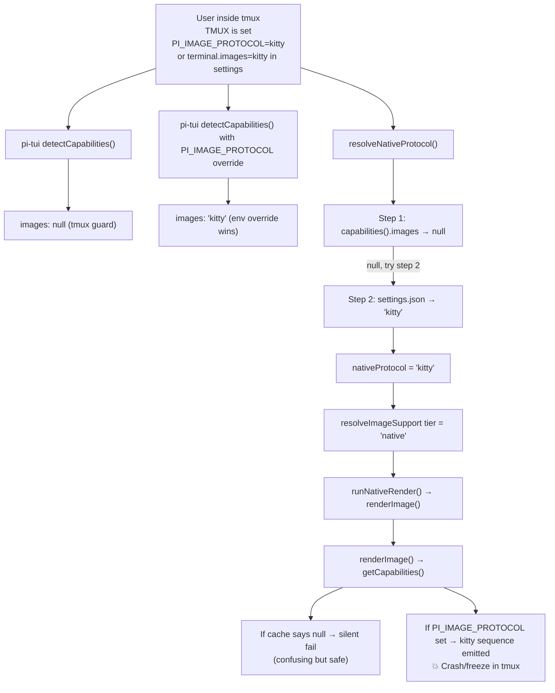

# pi-navigator Code Review Report

> **Scope:** Full codebase review (~16.5k lines across 20 source + 19 test files), skipping `./docs/`.
> **Focus areas:** Two user-reported image rendering issues, plus general code quality.

---

## Part 1 — Image Issue Investigation

### Issue A: Kitty Protocol Crash/Freeze in tmux

> [!CAUTION]
> **Severity: Critical** — This is a real crash vector caused by a bypass of pi-tui's tmux safety guard.

#### Root Cause

pi-tui's capability detection ([`terminal-image.js` L44-46](file:///home/jhonny/Sources/pi-navigator/node_modules/@earendil-works/pi-tui/dist/terminal-image.js#L44-L46)) **correctly** returns `images: null` under tmux:

```js
// Image protocols are unreliable under tmux, so leave `images: null`.
if (process.env.TMUX || term.startsWith("tmux")) {
    return { images: null, ... };
}
```

However, pi-navigator's `resolveNativeProtocol()` ([`images.ts` L770-791](file:///home/jhonny/Sources/pi-navigator/images.ts#L770-L791)) uses a **3-step ladder** that can bypass this safety check:

1. `capabilities().images` — reads the pi-tui cache → returns `null` under tmux ✅
2. `settings.json` → `terminal.images` — if the user has `"images": "kitty"` in their pi settings, this step returns `"kitty"` **even under tmux** ⚠️
3. `PI_IMAGE_PROTOCOL` env var — if the user has `PI_IMAGE_PROTOCOL=kitty` set, this step returns `"kitty"` **even under tmux** ⚠️

**Steps 2 and 3 have no tmux guard.** If the user has `terminal.images: "kitty"` in `~/.pi/agent/settings.json` (common for kitty/ghostty users), and then opens pi inside tmux, the navigator will resolve `nativeProtocol = "kitty"` via step 2, produce a `tier = "native"`, and emit raw kitty APC escape sequences (`\x1b_G...`) directly into the tmux PTY.

tmux does not understand the kitty graphics protocol (it uses APC `\x1b_G` sequences which tmux has limited support for). Depending on the tmux version and configuration:
- **Modern tmux (≥3.3a) with `allow-passthrough on`:** the sequence may partially work but often leaves orphaned placements or garbled state.
- **tmux without passthrough:** the APC sequence is either swallowed silently (leaving blank space where the image should be) or, in some builds, causes the pane to freeze/hang as tmux's input parser enters an unexpected state trying to consume the large base64 payload.

The pi host app avoids this because `renderImage()` in pi-tui ([`terminal-image.js` L473-476](file:///home/jhonny/Sources/pi-navigator/node_modules/@earendil-works/pi-tui/dist/terminal-image.js#L473-L476)) calls `getCapabilities()` internally and returns `null` when `caps.images` is `null`. But the navigator's `runNativeRender()` calls `renderImage()` after it has already decided the protocol is `kitty` based on the settings ladder — and `renderImage()` checks `getCapabilities()` again independently, so there are two possible outcomes:

- If the capabilities cache says `null`: `renderImage()` returns `null`, `runNativeRender` returns `{ok: false, reason: "native rendering is not available"}`, and the file degrades to a metadata card. This is the safe path, but it's confusing: the navigator "thinks" it's in native mode (header badge says "kitty") but every render silently fails.
- If `PI_IMAGE_PROTOCOL=kitty` is set **and** pi-tui's `detectCapabilities` picks it up (which it does — [`terminal-image.js` L95-100](file:///home/jhonny/Sources/pi-navigator/node_modules/@earendil-works/pi-tui/dist/terminal-image.js#L95-L100) applies the env override *after* the tmux early return), then `renderImage()` succeeds and emits the raw kitty sequence. **This is the crash path.**

#### Evidence Flow



#### Mitigation Needed

`resolveNativeProtocol()` should check for tmux (`process.env.TMUX` or `TERM` starting with `tmux`) and refuse to return a native protocol when detected, regardless of settings or env overrides. Alternatively, `runNativeRender` or the `renderNativeImage` seam in `index.ts` should check for tmux before emitting.

---

### Issue B: JPG/JPEG Falls Back to Chafa in Auto Mode (Kitty)

> [!IMPORTANT]
> **This is expected behavior by design** — the code intentionally gates kitty to PNG-only.

#### How It Works

The flow for a `.jpg` file under `mode: "auto"` with a kitty-capable terminal:

1. **`resolveImageSupport()`** runs, finds `nativeProtocol = "kitty"`, `preferNative = true`, so `tier = "native"`.

2. **`loadFileCached()` in `index.ts`** ([L289-291](file:///home/jhonny/Sources/pi-navigator/index.ts#L289-L291)) sees `tier === "native"` and injects `renderNativeImage` as the seam. Under auto mode, it also injects the chafa seam as fallback (`chafaFallback` at [L292-298](file:///home/jhonny/Sources/pi-navigator/index.ts#L292-L298)).

3. **`loadFile()` in `viewer.ts`** ([L375-411](file:///home/jhonny/Sources/pi-navigator/viewer.ts#L375-L411)) tries the **native seam first**. This calls `runNativeRender()`.

4. **`runNativeRender()`** hits the **mime gate** at [`images.ts` L861-863](file:///home/jhonny/Sources/pi-navigator/images.ts#L861-L863):
   ```ts
   if (ctx.protocol === "kitty" && mime !== "image/png") {
     return { ok: false, reason: bounded("kitty requires PNG") };
   }
   ```
   For `.jpg`, `mimeOfPath()` returns `"image/jpeg"`, which is not `"image/png"`, so this is a clean `{ok: false}` — no file is read.

5. **`loadFile()`** receives the clean failure and **falls through to the chafa seam** ([L412-453](file:///home/jhonny/Sources/pi-navigator/viewer.ts#L412-L453)), which renders the JPEG using chafa's symbol art.

This is the **intentional auto-mode degradation per file**: the spec (D5) says kitty protocol can only transmit PNG data, so non-PNG images fall back to chafa when available.

#### Why pi (the host app) Can Show JPGs Natively

pi's own Image component uses pi-tui's `renderImage()` which sends the raw JPEG bytes through the kitty protocol with `f=100` (PNG format flag). Modern kitty terminal actually accepts JPEG data despite the protocol spec saying PNG — kitty's implementation auto-detects the format from the data header. So:

- **pi-tui sends the raw bytes regardless** (it does not enforce PNG-only at the protocol layer)
- **pi-navigator enforces PNG-only at the mime gate** (conservative, spec-compliant approach)

The gap is that `runNativeRender()` in `images.ts` at [L861](file:///home/jhonny/Sources/pi-navigator/images.ts#L861) rejects non-PNG before even reading the file, while pi-tui's own `encodeKitty()` would happily accept JPEG bytes if given the chance (kitty the terminal handles it). The navigator is being **more conservative** than necessary for kitty (which supports JPEG), but this is a **deliberate design choice** per the comment on [`constants.ts` L121-124](file:///home/jhonny/Sources/pi-navigator/constants.ts#L121-L124):

```ts
/**
 * Extension → mime gate for native rendering (D5). "jpeg" not "jpg" because
 * pi-tui's getImageDimensions rejects "image/jpg"; bmp/ico/avif are
 * deliberately absent.
 */
```

The constant actually **maps** `jpg` and `jpeg` to `image/jpeg` ([L127-128](file:///home/jhonny/Sources/pi-navigator/constants.ts#L127-L128)), so the mime is resolved correctly. The rejection is purely the kitty protocol gate at L861 that says only PNG is allowed. If this restriction were relaxed (remove the kitty PNG-only check), JPEGs would render natively since pi-tui's `getImageDimensions` handles JPEG via `getJpegDimensions()` ([`terminal-image.js` L364-399](file:///home/jhonny/Sources/pi-navigator/node_modules/@earendil-works/pi-tui/dist/terminal-image.js#L364-L399)).

> [!NOTE]
> The `NATIVE_IMAGE_MIME` map at [`constants.ts` L125-131](file:///home/jhonny/Sources/pi-navigator/constants.ts#L125-L131) already includes `jpg`, `jpeg`, `gif`, and `webp`. The issue is purely the runtime gate at [`images.ts` L861](file:///home/jhonny/Sources/pi-navigator/images.ts#L861) that restricts kitty to PNG. Relaxing this for kitty (which actually supports JPEG/GIF/WebP) would enable native rendering for those formats, but would need careful testing since it departs from the documented kitty graphics protocol spec which officially says PNG.

---

## Part 2 — General Code Review Findings

### Critical / High Severity

| # | File | Lines | Finding |
|---|------|-------|---------|
| 1 | [`settings.ts`](file:///home/jhonny/Sources/pi-navigator/settings.ts#L223-L230) | L223-230 | **Infinity accepted as valid setting value.** `validateFieldValue` checks `!Number.isNaN()` but not `Number.isFinite()`, so `Infinity` passes validation. `JSON.stringify(Infinity)` produces `null`, silently corrupting the settings file. |
| 2 | [`settings.ts`](file:///home/jhonny/Sources/pi-navigator/settings.ts#L436-L441) | L436-441 | **`parseNumberField` accepts empty strings as 0.** `Number("")` returns `0` in JS. Empty input should be rejected, not silently accepted. |
| 3 | [`settings.ts`](file:///home/jhonny/Sources/pi-navigator/settings.ts#L420-L422) | L420-422 | **Fixed `.tmp` filename creates race condition.** Concurrent `/navigator settings` from multiple sessions write to the same `${path}.tmp`, risking interleaved writes. No cleanup on `renameSync` failure. |
| 4 | [`settings_menu.ts`](file:///home/jhonny/Sources/pi-navigator/settings_menu.ts#L61-L64) | L61-64 | **Number settings uneditable in TUI menu.** `values` is `[String(value)]` — a single-element array that cycles to itself. No text-input mechanism exists for numeric fields. |
| 5 | [`settings_menu.ts`](file:///home/jhonny/Sources/pi-navigator/settings_menu.ts#L29-L35) | L29-35 | **`fieldValue` crashes on partial settings.** No null/undefined guard inside the path traversal loop. Missing section → `TypeError` prevents the settings menu from opening. |
| 6 | [`settings_menu.ts`](file:///home/jhonny/Sources/pi-navigator/settings_menu.ts#L226-L228) | L226-228 | **Mouse release outside list area causes stale click state.** `handleMouse` drops events outside `[0, listHeight)`, leaving `mousePressedIndex` stale. Scroll wheel is dead in header/footer zones. |

### Medium Severity

| # | File | Lines | Finding |
|---|------|-------|---------|
| 7 | [`settings.ts`](file:///home/jhonny/Sources/pi-navigator/settings.ts#L186-L197) | L186-197 | **Warning cap per-section, not global.** A malformed config can emit up to 30 warnings (5 calls × 5 per call + summaries), defeating the anti-flood intent. |
| 8 | [`settings.ts`](file:///home/jhonny/Sources/pi-navigator/settings.ts#L40-L46) | L40-46 | **Shallow `readonly` on `NavigatorSettings`.** Top-level props are `readonly` but nested interfaces are mutable, allowing `settings.images.mode = "chafa"` which mutates shared references across `setField` structural sharing. |
| 9 | [`settings_menu.ts`](file:///home/jhonny/Sources/pi-navigator/settings_menu.ts#L289) | L289 | **Duplicate field ID in warning.** `applyFieldEdit` already embeds `for "fieldId"` in its error; the menu prepends `${id}:` again, producing `pi-navigator: images.mode: invalid value "x" for "images.mode"`. |
| 10 | [`settings_menu.ts`](file:///home/jhonny/Sources/pi-navigator/settings_menu.ts#L172) | L172 | **Fixed `MAX_VISIBLE_ROWS = 10` overflows small terminals.** With header/footer chrome the component needs ~16 rows; on terminals <16 rows it overflows. |
| 11 | [`settings_menu.ts`](file:///home/jhonny/Sources/pi-navigator/settings_menu.ts#L286-L301) | L286-301 | **Uncaught exception in `commit` leaves stale display.** `SettingsList` mutates `currentValue` before `onChange`; if `commit()` throws (not `{ok:false}`), `refreshRows` is never reached. |

### Low / Informational

| # | File | Lines | Finding |
|---|------|-------|---------|
| 12 | [`viewer.ts`](file:///home/jhonny/Sources/pi-navigator/viewer.ts#L79-L105) | L79-105 | **`sliceStyled` ignores OSC sequences.** Only CSI is matched; future OSC-8 hyperlinks from `highlightCode` would be treated as visible text and split mid-sequence. Safe today but fragile. |
| 13 | [`viewer.ts`](file:///home/jhonny/Sources/pi-navigator/viewer.ts#L584-L598) | L584-598 | **Full-file processing per horizontal scroll.** `computeRows` runs `sliceStyled` on all 5,000 lines per `hscroll` change. Cached by `cachedComputeRows` (by reference + value equality), but any change recomputes the entire set. |
| 14 | [`settings.ts`](file:///home/jhonny/Sources/pi-navigator/settings.ts#L193) | L193 | **Grammar: "1 more unknown settings" should be "setting" (singular).** |
| 15 | [`settings.ts`](file:///home/jhonny/Sources/pi-navigator/settings.ts#L155-L164) | L155-164 | **`deepFreezeDefaults` is only 2 levels deep** (despite the "deep" name). |
| 16 | [`settings.ts`](file:///home/jhonny/Sources/pi-navigator/settings.ts#L56-L63) | L56-63 | **`NavigatorConfigField` has unused properties.** `section` is populated but never consumed; `live` is always `false` and never branched on; `min`/`max` are declared but never populated. |
| 17 | [`settings.ts`](file:///home/jhonny/Sources/pi-navigator/settings.ts#L338) | L338 | **`parseImageMode` warning uses lowercased input.** `SIXEL` becomes `sixel` in the warning, while `parseIconMode` preserves original casing. Inconsistent UX. |
| 18 | [`settings_menu.ts`](file:///home/jhonny/Sources/pi-navigator/settings_menu.ts#L245-L256) | L245-256 | **Lazy dynamic import of pi-tui is defeated.** `index.ts` statically imports pi-tui on L29, so the `import()` call in `openSettingsMenu` adds no real module isolation. |
| 19 | [`tree.ts`](file:///home/jhonny/Sources/pi-navigator/tree.ts#L320-L331) | L320-331 | **`walkTree` abort semantics.** Returning `false` aborts the *entire* traversal, not just the subtree. Standard tree walkers use `false` for "skip children". |

---

## Part 3 — Test Suite Findings

558 test cases across 19 files. The suite is extensive but has some notable gaps:

### False Positives (Tests that Pass Even When Code is Broken)

| # | File | Finding |
|---|------|---------|
| 1 | [`navigator.test.ts` L544-569](file:///home/jhonny/Sources/pi-navigator/test/navigator.test.ts#L544-L569) | **Obsolete v2 commit-family cap test.** Builds a 20-commit chain, expands `c0`, asserts `childRows < 20`. Under v3 single-level semantics, expansion creates exactly 1 row — always < 20. If `FAMILY_MAX_ROWS` truncation were removed, this test still passes. |
| 2 | [`navigator.test.ts` L1444-1487](file:///home/jhonny/Sources/pi-navigator/test/navigator.test.ts#L1444-L1487) | **Search index clamping masked.** The test toggles `m` (reducing matches from 6 to 2) then types a *new* search query, resetting `searchIndex` to 0, masking whether `m` clamped the original index. |
| 3 | [`git.test.ts` L314-320](file:///home/jhonny/Sources/pi-navigator/test/git.test.ts#L314-L320) | **Git cache test doesn't verify caching.** Calls `isGitAvailable` twice and checks both return `true`, but never asserts that `execFile` wasn't called twice. Module-level variable was already `true` from prior tests. |
| 4 | [`viewer.test.ts` L163-166](file:///home/jhonny/Sources/pi-navigator/test/viewer.test.ts#L163-L166) | **Unicode smart-case test passes due to ASCII-only regex.** The `/[A-Z]/` check in `markMatches` doesn't detect `İ` (U+0130) as uppercase, so the test passes via case-insensitive fallback — the opposite of what it intends to test. |

### Critical Coverage Gaps

| # | File | Gap |
|---|------|-----|
| 1 | [`index.test.ts`](file:///home/jhonny/Sources/pi-navigator/test/index.test.ts) | **93% of `index.ts` untested.** 42 lines testing only `makeWarningNotifier`. Command routing (`settings`/`help`/`unknown`), overlay lifecycle, `registerEntryRenderer`, TUI check — all untested. |
| 2 | [`git.test.ts`](file:///home/jhonny/Sources/pi-navigator/test/git.test.ts) | **No detached HEAD, ahead/behind, buffer overflow, or empty-repo tests.** All documented states of `readGitState` that require specific repo configurations. |
| 3 | [`images.test.ts`](file:///home/jhonny/Sources/pi-navigator/test/images.test.ts) | **No tmux degradation tests.** The documented tmux/screen behavior (disabling native images) is never tested. Directly relevant to Issue A above. |

### Fragility / Flakiness

- **`(overlay as any)` casts**: 8 instances in `navigator.test.ts` inspect private fields (`viewHscroll`, `cachedLines`, `viewWrap`). Any internal refactor breaks tests despite identical behavior.
- **Wall-clock `setTimeout(10/20)`**: Used in async tests for file loads and mtime changes. Flaky under CI contention or coarse-granularity filesystems (HFS+, Docker volumes).

---

## Part 4 — Architecture and Quality Summary

### Strengths 💪
- **Exceptional separation of concerns.** Pure view-model modules (`frame.ts`, `files_view.ts`, `git_view.ts`, `viewer_view.ts`, `help_view.ts`) hold no state and are directly testable.
- **Robust resource bounding.** Memory caps (`MAX_HIGHLIGHT_BYTES`, `MAX_HIGHLIGHT_LINES`, `IMAGE_NATIVE_MAX_BYTES`) and cache bounds (`MAX_VIEWER_CACHE_ENTRIES`) prevent unbounded growth.
- **Thorough theme integration.** Zero hardcoded ANSI colors; everything routes through `NavigatorTheme`.
- **Width safety.** Consistent use of `visibleWidth`/`truncateToWidth` with empty ellipsis convention (Issue #010).
- **Defensive async patterns.** `loadSeq` race guard in `openRelPath`/`openCommit`, `inFlight` gate in `refreshData`, abort controllers for image loads.
- **Clean data contracts.** `ViewerFile` discriminated union covers every display state; setters (`setTree`/`setGitState`/`setImageSupport`) follow a consistent push pattern.
- **Comprehensive test suite.** 558 test cases across 19 files, with width-safety enforcement at multiple terminal sizes.

### Areas for Improvement 📋
- **tmux safety gap** is the most critical issue (see Issue A).
- **Settings type safety** could use discriminated unions to prevent invalid field configurations.
- **Number field editing** in the TUI settings menu is non-functional.
- **The conservative kitty PNG-only gate** may be worth relaxing given that modern kitty terminals accept JPEG/GIF/WebP natively (see Issue B).
- **`index.ts` test coverage** is severely lacking — the most complex lifecycle code in the project has essentially no tests.
- **Smart-case detection** uses ASCII-only `/[A-Z]/` which misses Unicode uppercase (e.g. Turkish İ).
