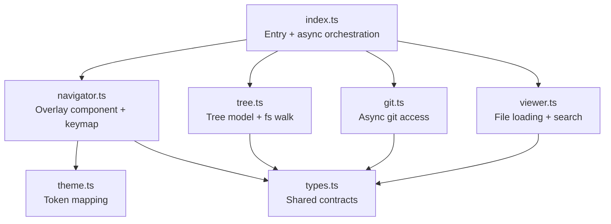

# pi-navigator — Code Review

> **Historical document.** This is a point-in-time review from the 5-suite / 99-case era, kept for provenance. Its findings were filed and are now tracked in [`docs/issues/issues_index.md`](issues/issues_index.md) — do not read this file as current conventions or current state.

---

## 🐛 Issue 1: UI breaks when opening a file to read

### Root cause

When a user presses Enter on a file in the files pane, [`handleFilesInput`](file:///home/jhonny/Sources/pi-navigator/navigator.ts#L438-L444) switches focus to the viewer and fires `openRelPath` as **fire-and-forget** (`void`):

```typescript
} else if (current && current.kind !== "dir") {
    this.focus = "viewer";
    void this.openRelPath(current.node.relPath);
}
```

[`openRelPath`](file:///home/jhonny/Sources/pi-navigator/navigator.ts#L192-L220) sets `viewLoading = true` synchronously, but only calls `requestRender()` **after** the async file load completes (in the `finally` block). In between:

1. **Focus is already `"viewer"`**, but `viewFile` is either `null` (first open) or still holding the **previous** file.
2. The render triggered by [`scheduleRender()`](file:///home/jhonny/Sources/pi-navigator/index.ts#L196) runs during this gap.

This creates a broken intermediate state:

| First file open | Subsequent file open |
|---|---|
| Viewer shows `(loading…)` — acceptable but focus highlight on the files pane cursor is now mismatched since focus moved to viewer | **Old file content renders** while the header shows `loading…` in the metadata. The files pane cursor highlights the new file, but the viewer shows the old file's content and path. The "open file" accent styling in the file row ([line 879](file:///home/jhonny/Sources/pi-navigator/navigator.ts#L879)) still highlights the **old** file since `this.viewFile?.relPath` hasn't changed yet |

Additionally, `buildRightRows` ([line 956](file:///home/jhonny/Sources/pi-navigator/navigator.ts#L956)) only shows the loading state when `viewFile` is **null**:

```typescript
if (!file && this.viewLoading) {
    // shows "(loading…)"
}
```

When there's already a file loaded, the loading state is completely invisible except for a subtle `loading…` metadata tag in the viewer header.

### Suggested fix

Set `viewFile` to a lightweight "loading placeholder" at the start of `openRelPath` instead of leaving the stale file in place. This ensures the viewer immediately shows the correct path in its header and displays a loading state:

```typescript
async openRelPath(relPath: string, keepScroll = false): Promise<void> {
    this.viewLoading = true;
    // Clear stale file so the viewer shows the loading state immediately
    // and the file-row accent highlights the correct path.
    if (this.viewFile?.relPath !== relPath) {
        this.viewFile = { kind: "text", relPath, lines: [], sizeBytes: 0 };
    }
    this.touch();
    this.requestRender();  // <-- trigger render NOW with the loading state
    // ...rest stays the same
```

> [!IMPORTANT]
> The intermediate `requestRender()` call is key — without it, the stale cached frame persists until the file finishes loading.

---

## 🐛 Issue 2: `ctrl+n` shortcut conflict on Pi

### Root cause

[`index.ts:216-221`](file:///home/jhonny/Sources/pi-navigator/index.ts#L216-L221) registers `ctrl+n` as a global shortcut:

```typescript
pi.registerShortcut("ctrl+n", {
    description: "Open pi-navigator",
    handler: async (ctx) => {
        await runNavigator(ctx);
    },
});
```

On Pi 0.85.1, `ctrl+n` is already bound to the built-in `app.session.toggleNamedFilter`. This causes Pi to print an `[Extension issues]` conflict banner at startup. The extension's binding wins (Pi uses the extension's handler), but the warning banner is noisy and the behavior isn't guaranteed to be stable across Pi versions.

This is already documented in the [README behavior notes](file:///home/jhonny/Sources/pi-navigator/README.md#L75) and [QA evidence](file:///home/jhonny/Sources/pi-navigator/plans/qa-evidence.md#L52-L56), and was acknowledged as a known issue.

### Suggested fix

Drop the `registerShortcut` call entirely. The `/navigator` command is the stable entry point. If a shortcut is desired, choose an unbound key (the plan's own conflict audit at [section 4](file:///home/jhonny/Sources/pi-navigator/plans/pi-navigator-implementation-plan.md#L225) originally flagged `ctrl+e` and `ctrl+g` as avoided, but didn't catch the `ctrl+n` conflict added in Pi 0.85.1).

**Option A** — Remove the shortcut:
```typescript
export default function (pi: ExtensionAPI): void {
    pi.registerCommand("navigator", {
        description: "Open the read-only project navigator (file tree, git state, viewer)",
        handler: async (_args, ctx) => {
            await runNavigator(ctx);
        },
    });
    // Shortcut removed: ctrl+n conflicts with pi's built-in toggleNamedFilter
}
```

**Option B** — Choose an unoccupied shortcut (e.g. `ctrl+shift+n`, `ctrl+alt+n`, or `ctrl+p` if available):
```typescript
pi.registerShortcut("ctrl+shift+n", {
    description: "Open pi-navigator",
    handler: async (ctx) => { await runNavigator(ctx); },
});
```

> [!NOTE]
> Whichever option you choose, update the README's Usage section (line 20) and the docstring in [`index.ts:5`](file:///home/jhonny/Sources/pi-navigator/index.ts#L5).

---

## General code review findings

### Architecture ✅ Well-structured

The module boundaries are clean and follow the plan's data ownership model:



- **`index.ts`** owns async work — no filesystem access in the overlay component
- **`navigator.ts`** is purely UI state + render — testable without a terminal
- **Data flows one-way** through setters (`setTree`, `setGitState`)
- Error handling is thorough — every code path returns a renderable state

### Code quality observations

| Area | Status | Notes |
|---|---|---|
| Error handling | ✅ Excellent | `loadFile` never throws; every failure returns a typed `ViewerFile`. Git calls degrade gracefully |
| Test coverage | ✅ Strong | 99 tests across 5 suites covering porcelain parsing, tree ops, viewer caps, keymap reducer, and render width safety |
| Type safety | ✅ Clean | `tsc --noEmit` passes. `noUncheckedIndexedAccess` is handled with `??` fallbacks throughout |
| Memory safety | ✅ Good | File reading is capped (`readCappedHead` for files > 1MB), binary sniffing reads only 4KB |
| Timer cleanup | ✅ Correct | `cleanup()` is called from both `close()` and `dispose()`, covering both user-initiated and framework-initiated teardown |
| Render caching | ✅ Reasonable | `cachedWidth` / `cachedLines` prevent redundant renders; `touch()` invalidates on state change |

### Minor issues & suggestions

1. **Phantom `x` in viewer hints** — [Line 57](file:///home/jhonny/Sources/pi-navigator/navigator.ts#L57) shows `h l x` in the viewer hint string, but there's no `x` key handler in `handleViewerInput`. This was likely intended as a "close" or placeholder keybinding that was removed but the hint wasn't cleaned up.

2. **`n`/`N` search navigation only works in normal mode, not search mode** — In [`handleSearchInput`](file:///home/jhonny/Sources/pi-navigator/navigator.ts#L335-L361), arrow keys cycle matches, but `n`/`N` don't. This is by design (they type into the search query), but the viewer hint at line 57 lists `n N` as if they always work. Consider clarifying the hint per-mode.

3. **`search` hint in HINTS is used both in the search bar footer and as a viewer fallback** — The HINTS record ([line 59](file:///home/jhonny/Sources/pi-navigator/navigator.ts#L59)) has `search` as a key, and the footer logic at [line 741](file:///home/jhonny/Sources/pi-navigator/navigator.ts#L741) falls through `HINTS[this.mode] ?? HINTS[this.focus]`. This means when in search mode, the footer shows the search hint, which is correct — but the fallback chain is fragile. A mode that isn't `"help"` and doesn't have a HINTS entry would silently fall through to the focus hint, which might not be the right behavior for future modes.

4. **`findNode` does redundant work** — [`findNode`](file:///home/jhonny/Sources/pi-navigator/tree.ts#L316-L328) uses `walkTree` but iterates `node.children` inside the visit callback, meaning it double-iterates. It could just check `node.relPath === relPath` directly in the visitor.

5. **`gitBinaryPresent` is a module-level mutable** — [Line 35 of `git.ts`](file:///home/jhonny/Sources/pi-navigator/git.ts#L35) caches the git availability check globally. If git becomes available or unavailable during a long-running session, this cache is stale. Acceptable for v0.1 but worth noting.

6. **Viewer `search` hint references `x`** — Same as finding #1. The `x` should be removed from the hint or a corresponding handler added.

7. **File watcher vs. polling** — The 3-second `setInterval` polling for file/git changes is pragmatic for v0.1, but for large repositories the overhead of repeated git calls could be noticeable. A `fs.watch`-based approach would be more efficient for the file-changed detection.

### Security & robustness

- ✅ Never writes to the workspace (clipboard copy is the only side effect)
- ✅ Git commands have 3s timeout, so a hung git process doesn't block the event loop
- ✅ Symlink cycle protection via `realpath` visited-set
- ✅ UTF-8 boundary handling (`decodeUtf8Head`) prevents replacement characters from capped reads
- ⚠️ `execFile` with `maxBuffer: 4MB` — a repository with very large git output could hit this. Acceptable for v1.
