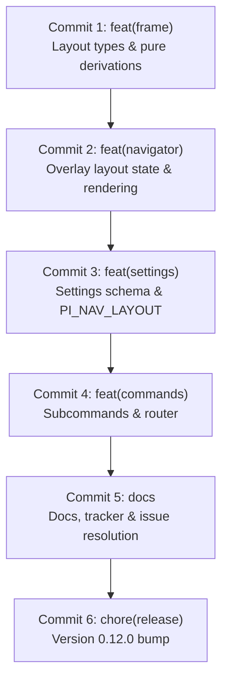

# pi-navigator — Overlay Layout Modes Implementation Plan

**Status:** Approved — Ready for Implementation  
**Spec Reference:** [`docs/specs/overlay-layout-modes.md`](file:///home/jhonny/Sources/pi-navigator/docs/specs/overlay-layout-modes.md)  
**Spec Review:** [`spec-review-overlay-layout-modes.md`](file:///home/jhonny/.gemini/antigravity-cli/brain/4fa2f3a5-cc14-4646-8faa-2df0f434ff93/spec-review-overlay-layout-modes.md)  
**Issue Reference:** [`docs/issues/119-overlay-layout-modes.md`](file:///home/jhonny/Sources/pi-navigator/docs/issues/119-overlay-layout-modes.md) (`#119`)  
**Target Version:** 0.12.0  
**Scope:** Support 3 overlay layout modes (`files-git-viewer`, `files-viewer`, `git-viewer`), slash subcommands (`/navigator all`, `/navigator files`, `/navigator git`), `layout.default` settings configuration with `PI_NAV_LAYOUT` environment override, and pure view-model geometry derivations in `frame.ts`.

---

## §0 — Grounding & Architecture Preconditions

1. **Pure View-Model Seam (Issue #064)**:
   - All layout geometry (`layoutPanes`, `layoutRows`), focus cycling (`cycleFocus`, `initialFocus`), and pane visibility (`visiblePanes`) are pure functions residing in [`frame.ts`](file:///home/jhonny/Sources/pi-navigator/frame.ts).
   - [`navigator.ts`](file:///home/jhonny/Sources/pi-navigator/navigator.ts) owns UI state only, calling these pure functions. The render path remains synchronous and free of filesystem or git calls.
2. **Single-Source Invariants (Issues #061, #063)**:
   - `NAVIGATOR_LAYOUTS` in [`types.ts`](file:///home/jhonny/Sources/pi-navigator/types.ts) is the single source for the closed layout union, router validation, and settings options.
   - `NAVIGATOR_CONFIG_FIELDS` in [`settings.ts`](file:///home/jhonny/Sources/pi-navigator/settings.ts) is the single source for settings defaults, normalization, serialization, and the settings menu.
   - `NAVIGATOR_SUBCOMMANDS` in [`help.ts`](file:///home/jhonny/Sources/pi-navigator/help.ts) is the single source for `/navigator` completions, help lines, and argument parsing.
3. **Separator Guard in `render()`**:
   - In `git-viewer`, `filesH === 0`. The horizontal separator must be drawn **only** when `layout === "files-git-viewer"` (or when `layoutPanes(layout).files && layoutPanes(layout).git`), preventing line 0 from being rendered as a separator bar instead of the git header.
4. **`filesArea` Non-Zero Floor**:
   - `filesArea(termRows, layout)` evaluates to `Math.max(2, layoutRows(body, layout).filesH - 1)`. When `filesH === 0`, it safely returns `2`, preventing divide-by-zero or negative scroll clamps if `alignFilesCursor` is triggered by opening a file from git history in `git-viewer` mode.
5. **Continuous Green Build**:
   - Every commit must leave `npm run typecheck` and `npm test` (all 20 suites, 672+ tests) completely green.

---

## §1 — Commit Slicing & Implementation Plan



---

### Step 1: `feat(frame)` — Layout Model & Pure Derivations

#### 1.1 Types Extension ([`types.ts`](file:///home/jhonny/Sources/pi-navigator/types.ts))
Define and export the layout array and union:
```typescript
export const NAVIGATOR_LAYOUTS = ["files-git-viewer", "files-viewer", "git-viewer"] as const;
export type NavigatorLayout = (typeof NAVIGATOR_LAYOUTS)[number];
```

#### 1.2 Geometry & Derivations ([`frame.ts`](file:///home/jhonny/Sources/pi-navigator/frame.ts))
1. Import `NAVIGATOR_LAYOUTS` and `NavigatorLayout` from `./types.js`.
2. Define `LayoutPanes`:
   ```typescript
   export interface LayoutPanes {
     readonly files: boolean;
     readonly git: boolean;
   }
   ```
3. Implement pure functions:
   - `layoutPanes(layout: NavigatorLayout): LayoutPanes`
     - `"files-git-viewer"`: `{ files: true, git: true }`
     - `"files-viewer"`: `{ files: true, git: false }`
     - `"git-viewer"`: `{ files: false, git: true }`
   - `layoutRows(body: number, layout: NavigatorLayout): { filesH: number; gitH: number }`
     - `"files-git-viewer"`: delegates to `splitRows(body)`
     - `"files-viewer"`: `{ filesH: body, gitH: 0 }`
     - `"git-viewer"`: `{ filesH: 0, gitH: body }`
   - `visiblePanes(layout: NavigatorLayout): readonly Focus[]`
     - `"files-git-viewer"`: `["files", "git", "viewer"]`
     - `"files-viewer"`: `["files", "viewer"]`
     - `"git-viewer"`: `["git", "viewer"]`
   - `initialFocus(layout: NavigatorLayout): Focus`
     - `"git-viewer"`: `"git"`
     - `"files-git-viewer"` / `"files-viewer"`: `"files"`
   - `cycleFocus(focus: Focus, direction: 1 | -1, layout: NavigatorLayout): Focus`
     - Wraps within `visiblePanes(layout)`
     - If current `focus` is not visible, defaults to `visiblePanes(layout)[0]`
4. Update `filesArea`:
   ```typescript
   export function filesArea(termRows: number, layout: NavigatorLayout = "files-git-viewer"): number {
     const overlayH = overlayHeight(termRows);
     const body = bodyRows(overlayH);
     return Math.max(2, layoutRows(body, layout).filesH - 1);
   }
   ```
   *(Default parameter keeps existing call sites green until Step 2).*
5. Update `FooterView` and `buildFooterRow`:
   - Add `layout?: NavigatorLayout` to `FooterView`.
   - In `buildFooterRow`, derive pane labels via `visiblePanes(view.layout ?? "files-git-viewer")`.

#### 1.3 Test Suite ([`test/frame.test.ts`](file:///home/jhonny/Sources/pi-navigator/test/frame.test.ts))
- Test `layoutPanes` across all three layouts.
- Test `layoutRows` across all layouts (including minimum body rows).
- Test `visiblePanes` ordering.
- Test `initialFocus` for all three layouts.
- Test `cycleFocus`: forward (`1`), backward (`-1`), wrap-around, and invalid focus recovery.
- Test `filesArea(rows, layout)` for all layouts (e.g. 24 for `files-viewer` at 36 rows, 12 for default layout, floor of 2 for `git-viewer`).
- Test `buildFooterRow` label generation for each layout (`files  viewer`, `git  viewer`, `files  git  viewer`).
- **Verification**: `npm run typecheck && npm test`

---

### Step 2: `feat(navigator)` — Overlay Component State & Rendering

#### 2.1 State & Options ([`navigator.ts`](file:///home/jhonny/Sources/pi-navigator/navigator.ts))
1. Import `NavigatorLayout`, `layoutPanes`, `layoutRows`, `initialFocus`, `cycleFocus` from `./frame.js`.
2. Add `initialLayout?: NavigatorLayout` to `NavigatorOptions`.
3. Add `private layout: NavigatorLayout;` to `NavigatorOverlay`.
4. In constructor:
   ```typescript
   this.layout = options.initialLayout ?? "files-git-viewer";
   this.focus = initialFocus(this.layout);
   ```
5. Rename `private showTree = true` to `private showLeftColumn = true`:
   - Declaration ([line 185](file:///home/jhonny/Sources/pi-navigator/navigator.ts#L185)).
   - Toggle on `t` key in `handleNormalInput` ([line 718](file:///home/jhonny/Sources/pi-navigator/navigator.ts#L718)).
   - Usage in `render()` ([line 1210](file:///home/jhonny/Sources/pi-navigator/navigator.ts#L1210)): `useLeftColumn(innerW, body, this.showLeftColumn)`.
6. Update Tab / Shift+Tab cycling in `handleNormalInput`:
   ```typescript
   const isShiftTab = matchesKey(data, Key.shift("tab"));
   if (isShiftTab || matchesKey(data, Key.tab)) {
     this.focus = cycleFocus(this.focus, isShiftTab ? -1 : 1, this.layout);
     this.touch();
     return;
   }
   ```
7. Update `filesArea` call sites to pass `this.layout`:
   - [`navigator.ts:740`](file:///home/jhonny/Sources/pi-navigator/navigator.ts#L740) in `handleFilesInput`.
   - [`navigator.ts:1333`](file:///home/jhonny/Sources/pi-navigator/navigator.ts#L1333) in `ensureFilesCursorVisible()`.

#### 2.2 Rendering Orchestration ([`navigator.ts`](file:///home/jhonny/Sources/pi-navigator/navigator.ts))
1. In `render(width: number)`:
   - Compute `const { filesH, gitH } = layoutRows(body, this.layout);`.
   - Pass `{ filesH, gitH }` to `this.buildLeftRows(leftW, { filesH, gitH }, body)`.
   - In body composition loop, guard horizontal separator:
     ```typescript
     const showSeparator = this.layout === "files-git-viewer";
     if (showSeparator && i === filesH) {
       lines.push(
         T.frame("├") + T.frame("─".repeat(leftW)) + T.frame("┼") + rightRows[i] + T.frame("│"),
       );
     } else {
       lines.push(T.frame("│") + leftRows[i] + T.frame("│") + rightRows[i] + T.frame("│"));
     }
     ```
   - Pass `layout: this.layout` to `buildFooterRow`.
2. In `buildLeftRows(leftW: number, heights: { filesH: number; gitH: number }, body: number)`:
   - Read `panes = layoutPanes(this.layout)`.
   - Emit files header + `heights.filesH - 1` rows only when `panes.files`.
   - Emit separator placeholder `padTo("", leftW)` only when `this.layout === "files-git-viewer"`.
   - Emit git header + `heights.gitH - 1` rows only when `panes.git`.
   - Always returns exactly `body` rows.

#### 2.3 Keybinding Descriptions ([`help.ts`](file:///home/jhonny/Sources/pi-navigator/help.ts))
Update `NAVIGATOR_KEYBINDINGS`:
- `cycle-focus`: `"cycle pane focus (visible panes)"`
- `toggle-tree`: `"hide or show the left column"`

#### 2.4 Testing ([`test/navigator.test.ts`](file:///home/jhonny/Sources/pi-navigator/test/navigator.test.ts), [`test/render.test.ts`](file:///home/jhonny/Sources/pi-navigator/test/render.test.ts), [`test/help.test.ts`](file:///home/jhonny/Sources/pi-navigator/test/help.test.ts))
- Default layout byte-identity when `initialLayout` is omitted.
- `files-viewer`: files pane full height (`body - 1` rows), no git header or separator, Tab cycles `files <-> viewer`.
- `git-viewer`: git panel full height (`body - 1` rows), no files header or separator, initial focus `git`, Tab cycles `git <-> viewer`, `/` filter unreachable.
- `t` key hides/shows left column across all 3 layouts.
- Width-safety tests at 120, 100, 80, 74, and 60 columns.
- Update `test/help.test.ts` for updated keybinding descriptions.
- **Verification**: `npm run typecheck && npm test`

---

### Step 3: `feat(settings)` — Settings Schema & Environment Resolution

#### 3.1 Constants & Types ([`constants.ts`](file:///home/jhonny/Sources/pi-navigator/constants.ts), [`settings.ts`](file:///home/jhonny/Sources/pi-navigator/settings.ts))
1. In `constants.ts`, export:
   ```typescript
   export const NAVIGATOR_LAYOUT_ENV = "PI_NAV_LAYOUT";
   ```
2. In `settings.ts`, define `NavigatorLayoutSettings`:
   ```typescript
   export interface NavigatorLayoutSettings {
     readonly default: NavigatorLayout;
   }
   ```
3. Update `NavigatorSettings`:
   ```typescript
   export interface NavigatorSettings {
     readonly version: number;
     readonly images: NavigatorImageSettings;
     readonly icons: NavigatorIconSettings;
     readonly viewer: NavigatorViewerSettings;
     readonly tree: NavigatorTreeSettings;
     readonly layout: NavigatorLayoutSettings;
   }
   ```

#### 3.2 Registry & Normalizer ([`settings.ts`](file:///home/jhonny/Sources/pi-navigator/settings.ts))
1. Append `layout.default` to `NAVIGATOR_CONFIG_FIELDS`:
   ```typescript
   {
     id: "layout.default",
     path: ["layout", "default"],
     kind: "enum",
     section: "Layout",
     label: "Default layout",
     description: "Layout opened by bare /navigator; /navigator all, /navigator files, and /navigator git always open their own layout for one session.",
     options: [...NAVIGATOR_LAYOUTS],
     default: "files-git-viewer",
     live: false,
   }
   ```
2. Implement `parseLayoutMode`:
   ```typescript
   export function parseLayoutMode(value: string | undefined): { layout: NavigatorLayout | undefined; warning?: string } {
     if (value === undefined) return { layout: undefined };
     const trimmed = value.trim();
     if (trimmed === "") return { layout: undefined };
     if ((NAVIGATOR_LAYOUTS as readonly string[]).includes(trimmed)) {
       return { layout: trimmed as NavigatorLayout };
     }
     return {
       layout: undefined,
       warning: `${trimmed} is not a valid ${NAVIGATOR_LAYOUT_ENV} value; using the file/default setting`,
     };
   }
   ```
3. In `loadNavigatorSettings`:
   - Accept `layout?: string | undefined` in `paths.env`.
   - Apply `parseLayoutMode(paths.env?.layout)` override to `settings.layout.default`, capturing warnings.

#### 3.3 Menu & Index Integration ([`index.ts`](file:///home/jhonny/Sources/pi-navigator/index.ts))
1. In `runNavigator`: Pass `layout: process.env[NAVIGATOR_LAYOUT_ENV]` to `loadNavigatorSettings`.
2. In `runSettings`:
   ```typescript
   const layoutEnv = process.env[NAVIGATOR_LAYOUT_ENV];
   if (layoutEnv !== undefined && layoutEnv.trim() !== "") overrides["layout.default"] = NAVIGATOR_LAYOUT_ENV;
   ```

#### 3.4 Testing ([`test/settings.test.ts`](file:///home/jhonny/Sources/pi-navigator/test/settings.test.ts), [`test/settings_menu.test.ts`](file:///home/jhonny/Sources/pi-navigator/test/settings_menu.test.ts))
- Update `NAVIGATOR_CONFIG_FIELDS` length check from 5 to 6 fields.
- Test `layout.default` normalization, serialization, and `applyFieldEdit`.
- Test `parseLayoutMode` truth table: unset, whitespace, valid values, invalid values with formatted warning.
- Test settings menu displays "Default layout" row and annotates with `— overridden by PI_NAV_LAYOUT (env wins)` when env is set.
- **Verification**: `npm run typecheck && npm test`

---

### Step 4: `feat(commands)` — Layout Subcommands & Dispatch

#### 4.1 Help Subcommand Registry ([`help.ts`](file:///home/jhonny/Sources/pi-navigator/help.ts))
1. Update `NavigatorSubcommand` interface to carry `readonly layout?: NavigatorLayout;`.
2. Add the three layout subcommands before `settings`/`help`:
   ```typescript
   export const NAVIGATOR_SUBCOMMANDS: readonly NavigatorSubcommand[] = [
     { cmd: `${NAVIGATOR_CMD_PREFIX}all`, desc: "open overlay with files and git panes (default)", completionLabel: "Open files + git + viewer overlay", layout: "files-git-viewer" },
     { cmd: `${NAVIGATOR_CMD_PREFIX}files`, desc: "open overlay with files pane only", completionLabel: "Open files + viewer overlay", layout: "files-viewer" },
     { cmd: `${NAVIGATOR_CMD_PREFIX}git`, desc: "open overlay with git panel only", completionLabel: "Open git + viewer overlay", layout: "git-viewer" },
     { cmd: `${NAVIGATOR_CMD_PREFIX}settings`, desc: "configure images, icons, viewer, tree, and layout behavior", completionLabel: "Open the settings menu" },
     { cmd: `${NAVIGATOR_CMD_PREFIX}help`, desc: "show this command list", completionLabel: "Show the command list" },
   ];
   ```

#### 4.2 Parser & Router ([`index.ts`](file:///home/jhonny/Sources/pi-navigator/index.ts))
1. Update `ParsedNavigatorArgs`:
   ```typescript
   export type ParsedNavigatorArgs =
     | { readonly kind: "overlay" }
     | { readonly kind: "settings" }
     | { readonly kind: "help" }
     | { readonly kind: "layout"; readonly layout: NavigatorLayout }
     | { readonly kind: "unknown"; readonly raw: string };
   ```
2. Update `parseNavigatorArgs(args: string)`:
   - Match first token against `NAVIGATOR_SUBCOMMANDS`.
   - If `sub.layout !== undefined`, return `{ kind: "layout", layout: sub.layout }`.
   - If `"settings"` or `"help"`, return `{ kind: token }`.
   - Otherwise `{ kind: "unknown", raw: token }`.
3. Update `runNavigator`:
   - Accept optional `layoutOverride?: NavigatorLayout`.
   - Pass `initialLayout: layoutOverride ?? loaded.settings.layout.default` into `NavigatorOverlay`.
4. In `pi.registerCommand("navigator", ...)` handler:
   - Add `case "layout": await runNavigator(pi, ctx, parsed.layout); return;`.

#### 4.3 Testing ([`test/help.test.ts`](file:///home/jhonny/Sources/pi-navigator/test/help.test.ts), [`test/index.test.ts`](file:///home/jhonny/Sources/pi-navigator/test/index.test.ts))
- In `test/help.test.ts`:
  - Update `NAVIGATOR_COMMANDS` length assertion (6 total rows: bare `/navigator` + 5 subcommands).
  - Update `buildHelpLines` output assertions.
  - Update single-source derivation test to check `{ kind: "layout", layout: sub.layout }` when `sub.layout !== undefined`.
- In `test/index.test.ts`:
  - Verify `parseNavigatorArgs` routes `all`, `files`, and `git` to `{ kind: "layout" }`.
  - Verify completions return all 5 subcommands with prefix filtering.
  - Verify router dispatches layout commands with layout override and bare `/navigator` uses settings default.
- **Verification**: `npm run typecheck && npm test`

---

### Step 5: `docs` — Documentation, Tracker & Issue Resolution

#### 5.1 Documentation Updates
1. [`README.md`](file:///home/jhonny/Sources/pi-navigator/README.md):
   - Add Layouts section with layout summary table.
   - Update subcommand list with `/navigator all`, `/navigator files`, `/navigator git`.
   - Document `layout.default` setting and `PI_NAV_LAYOUT` environment variable.
2. [`AGENTS.md`](file:///home/jhonny/Sources/pi-navigator/AGENTS.md):
   - Update overview paragraph with layout-aware description.
   - Update module descriptions for `types.ts`, `frame.ts`, `navigator.ts`, `settings.ts`, `help.ts`, `index.ts`.

#### 5.2 Tracker Update
1. [`docs/issues/119-overlay-layout-modes.md`](file:///home/jhonny/Sources/pi-navigator/docs/issues/119-overlay-layout-modes.md):
   - Set status to `Resolved`.
   - Check off all acceptance criteria and document test evidence.
2. [`docs/issues/issues_index.md`](file:///home/jhonny/Sources/pi-navigator/docs/issues/issues_index.md):
   - Move `#119` from Pending to Resolved table.
   - Update overview counts table: Pending Medium `-1`, Resolved Medium `+1`.

#### 5.3 Testing ([`test/docs.test.ts`](file:///home/jhonny/Sources/pi-navigator/test/docs.test.ts))
- Run `npm test test/docs.test.ts` to confirm documentation and tracker guards pass.
- **Verification**: `npm run typecheck && npm test`

---

### Step 6: `chore(release)` — Version Bump & Reinstall

1. Bump `version` in [`package.json`](file:///home/jhonny/Sources/pi-navigator/package.json) to `0.12.0`.
2. Run `pi install .` to update local host registration.
3. Run full verification: `npm run typecheck && npm test`.
